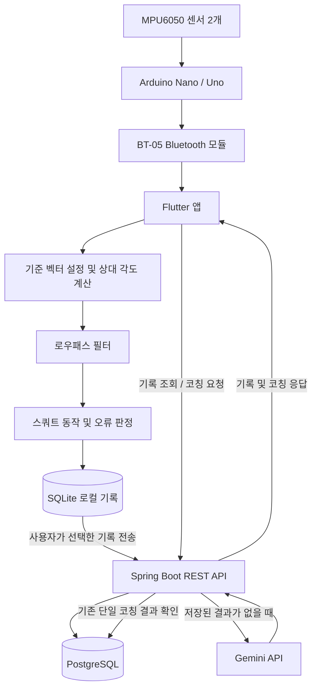

# SquatMate 🏋️

**실시간 센서 데이터와 AI 코칭을 활용한 스마트 스쿼트 운동 관리 서비스**

SquatMate는 신체에 부착한 센서를 통해 스쿼트 동작을 측정하고, 운동 기록과 자세 오류를 분석하여 AI 기반 코칭을 제공하는 개인 프로젝트입니다.

Flutter 기반 모바일 애플리케이션과 Spring Boot 서버, Arduino 및 MPU6050 센서를 연동하여 운동 데이터 수집부터 기록 관리, AI 피드백 제공까지의 과정을 구현했습니다.

## 📌 Project Overview

- **개발 기간:** 2026.06 ~ 2026.10
- **프로젝트 유형:** 개인 프로젝트
- **담당 역할:** 모바일 앱, 백엔드 서버, 하드웨어 연동 및 개발
- **주요 목표:** 센서 기반 스쿼트 동작 분석과 AI 맞춤형 운동 피드백 제공

## 🛠 Tech Stack

### Mobile
- Flutter
- Dart
- Bluetooth 기반 센서 데이터 수신
- SQLite 기반 로컬 운동 기록 관리

### Backend
- Java 21
- Spring Boot
- REST API
- JWT 기반 사용자 인증
- Gemini API 기반 AI 코칭

### Database & Deployment
- PostgreSQL
- Supabase
- Render

### Hardware
- Arduino Nano × 1
- Arduino Uno × 1
- MPU6050 × 2
- BT-05 Bluetooth 모듈 × 2

## ✨ Key Features

### 1. 실시간 스쿼트 동작 분석
- 허리와 허벅지에 부착한 MPU6050 센서 데이터 수신
- 기준 자세의 벡터를 저장하고 현재 벡터와 비교하여 상대 각도 계산
- 로우패스 필터를 적용한 각도 데이터로 스쿼트 동작 판정
- 허리 각도, 최대 허벅지 각도, 수행 시간을 기준으로 오류 분류

### 2. 운동 기록 및 통계
- 운동 수행 결과와 자세 오류 기록
- SQLite에 운동 기록을 우선 저장
- 사용자가 선택한 기록을 서버에 전송
- 누적 운동 기록 및 기간별 통계 조회

### 3. AI 기반 운동 코칭
- 개별 운동 기록에 대한 AI 코칭
- 여러 운동 기록을 종합한 AI 코칭
- 단일 기록의 코칭 결과를 서버 DB에 저장하여 재사용

### 4. 사용자 인증 및 데이터 관리
- JWT 기반 사용자 인증
- 사용자별 운동 기록 관리
- 로그인 및 로그아웃 기능

## 🏗 System Architecture



### Data Flow

1. 허리와 허벅지에 배치한 MPU6050 센서가 각각 3축 가속도 데이터를 측정합니다.
2. 각 센서 데이터는 Arduino 보드를 거쳐 BT-05 Bluetooth 모듈을 통해 Flutter 앱으로 전달됩니다.
3. 앱은 운동 시작 시 저장한 기준 벡터와 현재 벡터 사이의 상대 각도를 계산합니다.
4. 계산된 각도에 저역 통과 필터를 적용한 뒤, 스쿼트 횟수와 자세 오류를 판정합니다.
5. 운동 기록은 SQLite에 먼저 저장됩니다.
6. 사용자가 전송할 기록을 선택하면 앱이 REST API를 통해 서버에 전송합니다.
7. 서버는 사용자별 기록을 PostgreSQL에 저장하고, 기록 조회 및 AI 코칭 요청을 처리합니다.

### Hardware Configuration

- 허리 측정 모듈: Arduino Uno + MPU6050 + BT-05
- 허벅지 측정 모듈: Arduino Nano + MPU6050 + BT-05

펌웨어는 허리 데이터를 `$W|x,y,z`, 허벅지 데이터를 `$T|x,y,z` 형식으로 구분해 전송합니다. 펌웨어의 `delay(20)` 설정을 기준으로 약 20ms 간격(이론상 약 50Hz)으로 데이터를 읽고 전송하도록 구성했습니다. 실제 수신 주기는 블루투스 통신 및 앱 처리 상황에 따라 달라질 수 있습니다.

두 모듈은 각각 독립적으로 센서 데이터를 수집해 스마트폰으로 전송합니다. Uno와 Nano를 서로 다르게 사용한 것은 특정 보드 조합이 필수여서가 아니라, 개발 당시 보유하고 있던 보드를 활용했기 때문입니다. Arduino의 주된 역할은 MPU6050에서 가속도 데이터를 읽고 이를 스마트폰으로 전달하는 것이므로, 향후에는 필요한 기능과 통신 조건을 충족하는 더 저렴한 마이크로컨트롤러를 검토해 하드웨어 비용을 줄일 수 있습니다. 이는 향후 개선 가능성이며, 현재 구현하거나 성능을 검증한 사항은 아닙니다.

### Relative Angle Calculation

앱은 영점 설정 시 수집한 기준 가속도 벡터와 이후 수신되는 현재 가속도 벡터 사이의 각도를 계산합니다. 두 벡터의 내적을 이용해 상대 각도를 구하며, 계산 결과는 도(degree) 단위로 변환합니다.

이 값은 기준 벡터에 대한 상대적인 기울기를 나타내며, 실제 무릎 관절 각도를 직접 측정한 값은 아닙니다. 또한 가속도 센서는 움직임 중 동적 가속도의 영향을 받을 수 있으므로, 계산된 각도와 실제 신체 부위의 방향이 항상 일치한다고 보장할 수는 없습니다.

## ⚙️ Squat Analysis Logic

SquatMate는 허벅지 각도를 이용해 한 번의 스쿼트 동작을 구분하고, 허리 각도·최대 허벅지 각도·수행 시간을 각각 검사합니다.

| 판정 항목 | 정상 조건 | 오류 조건 |
|---|---|---|
| 동작 시작 | 허벅지 각도 40° 초과 시 시작 감지 | — |
| 동작 종료 | 허벅지 각도 15° 이하로 돌아오면 한 회 정산 | — |
| 허리 각도 | 40° 이하 | 40° 초과 |
| 최대 허벅지 각도 | 85° 이상 | 85° 미만 |
| 한 회 수행 시간 | 3초 이상 | 3초 미만 |

각 오류 조건은 독립적으로 검사합니다. 따라서 한 번의 스쿼트에서 허리 각도, 깊이, 수행 시간 오류가 동시에 기록될 수 있습니다.

> **판정 기준의 범위:** 위 각도는 프로젝트에서 설정한 초기 기준이며 모든 사용자의 신체 특성과 스쿼트 자세를 절대적으로 정의하는 값은 아닙니다. 신체 비율, 유연성, 센서 부착 상태에 따라 측정 결과가 달라질 수 있습니다.

## 🧠 Technical Decisions

### 1. PostgreSQL로 데이터베이스 통합

기존에는 로컬 개발 환경에서 MariaDB를, 배포 환경에서는 PostgreSQL을 사용했지만, 환경마다 서로 다른 데이터베이스를 관리하면 설정과 테스트가 복잡해질 수 있었습니다. 이를 줄이기 위해 저장소의 데이터베이스 구성을 PostgreSQL로 통합했습니다.

이제 로컬과 배포 환경에서 같은 데이터베이스 엔진을 기준으로 개발할 수 있으며, 접속 주소와 계정 정보는 환경에 맞게 별도로 설정합니다. 데이터베이스 엔진을 통일하더라도 로컬 데이터와 배포 데이터가 자동으로 공유되는 것은 아니며, 각 환경의 접속 정보와 데이터는 분리해 관리합니다.

### 2. 앱 중심의 실시간 스쿼트 분석

블루투스로 수신하는 센서 데이터의 각도 계산과 스쿼트 판정을 Flutter 앱에서 처리하도록 설계했습니다. 해당 연산은 모바일 기기에서 처리할 수 있는 수준이며, 실시간 응답이 중요하기 때문에 매 데이터마다 서버 통신을 수행하는 구조를 피했습니다.

또한 측정과 판정을 앱에서 수행함으로써 서버 연결과 운동 측정을 분리할 수 있는 구조를 고려했습니다. 다만 서버 연결 없이 운동한 기록을 나중에 동기화하는 전체 오프라인 사용 경험은 실제 구현 범위를 기준으로 확인해야 합니다.

### 3. 로컬 기록과 서버 기록의 분리

운동 기록을 SQLite에 먼저 저장하고, 사용자가 선택한 기록을 서버로 전송하도록 구현했습니다. 이를 통해 로컬 기록과 서버 기록을 분리하고, 서버에 보낼 기록을 사용자가 직접 선택할 수 있도록 했습니다.

서버 전송에 성공한 기록은 동기화 상태를 갱신하며, 전송에 실패한 기록은 다시 전송할 수 있도록 미동기화 상태로 유지합니다.

### 4. 단일 AI 코칭 결과 캐싱

Gemini API의 호출 제한과 토큰 사용량을 고려해 단일 운동 기록의 코칭 결과를 서버 DB에 함께 저장하도록 구현했습니다. 코칭 요청 시 기존 결과가 있으면 재사용하고, 결과가 없을 때만 Gemini API를 호출합니다.

이를 통해 동일한 기록에 대한 중복 API 호출을 줄이고, 같은 기록에 대해 일관된 코칭 결과를 제공하도록 설계했습니다.

종합 코칭은 사용자가 선택한 여러 기록의 통계를 바탕으로 생성합니다. 현재 종합 코칭 결과는 별도로 저장하지 않으므로, 동일한 조건으로 다시 요청해도 AI API가 재호출될 수 있습니다. 이는 여러 기록 조합별 결과를 저장하고 관리하는 복잡성을 줄이기 위한 선택입니다.

### 5. 로우패스 필터를 활용한 센서 노이즈 완화

SquatMate는 센서에서 수신한 가속도 벡터를 이용해 허리와 허벅지의 상대 각도를 계산하고, 해당 각도를 기반으로 스쿼트 횟수와 자세 오류를 판정합니다.

초기 구현에서는 필터 없이 센서 각도를 이용해 동작을 판정했습니다. 그러나 정지 상태에서도 각도 값이 흔들리면서 스쿼트 깊이를 잘못 판정하거나 동작을 안정적으로 인식하지 못하는 문제가 발생했습니다. 실시간 각도 UI 역시 불안정하게 흔들렸습니다.

이를 완화하기 위해 이전 필터링 값과 현재 원본 값을 결합하는 1차 저역통과 필터를 적용했습니다. 현재 필터 계수는 0.15이며, 이전 필터링 값에 85%, 현재 원본 값에 15%의 가중치를 적용합니다.

```text
filtered = previous_filtered × 0.85 + current_raw × 0.15
```

이 방식은 순간적인 노이즈의 영향을 줄이고 각도 표시와 판정 입력값을 안정화하는 데 목적이 있습니다. 실제 테스트에서도 필터 적용 후 잘못된 오류 판정이 크게 줄어드는 것을 확인했습니다.

반면 필터가 실제 각도 변화를 늦게 반영할 수 있어, 빠른 동작에서는 최대 각도를 충분히 반영하지 못할 가능성이 있습니다. 한 회 수행 시간이 3초 미만인 경우 빠른 수행 오류로 분류하도록 구성해, 센서 데이터 안정화와 통제된 운동 속도 유도를 함께 고려했습니다. 다만 빠른 수행 판정이 필터 지연 자체를 보정하는 것은 아닙니다.

### 6. 기준 벡터 재설정 기능

하드웨어 프로토타입을 착용하고 테스트하는 과정에서 허리와 허벅지 센서의 부착 위치와 각도를 매번 동일하게 유지하기 어렵다는 문제를 확인했습니다. 센서 부착 상태가 달라지면 기존 기준 벡터를 그대로 사용하기 어려워지고, 상대 각도 계산과 스쿼트 판정에도 영향을 줄 수 있었습니다.

이를 해결하기 위해 블루투스 연결을 반복해서 해제하고 다시 연결하는 대신, 앱에서 기준 벡터를 재설정할 수 있도록 구현했습니다. 운동 시작 또는 초기화 버튼을 누르면 영점 설정 과정을 거치며, 사용자는 똑바로 선 자세를 유지해야 합니다. 앱에서 영점 설정 안내가 사라지고 운동 시작 안내가 표시되면 측정을 시작할 수 있습니다.

이 기능은 하드웨어 부착 상태를 완벽하게 고정하기 어려운 초기 프로토타입의 한계를 보완하기 위한 설계입니다. 기준 벡터를 재설정한다고 센서 부착 오차 자체가 사라지는 것은 아니지만, 달라진 착용 상태에 대응할 수 있습니다.

### 7. 독립적인 오류 판정 구조

초기에는 하나의 스쿼트 동작에서 여러 자세 오류를 판정하는 로직이 서로 복잡하게 얽혀 있었습니다. 하강과 상승 과정을 세분화하고 각 과정에서 발생한 오류를 구분하는 방식은 구현과 유지보수가 복잡하고 예외 상황도 많았습니다.

이를 개선하기 위해 각 오류 조건을 독립적으로 검사하도록 구조를 단순화했습니다. 한 번의 스쿼트에서 허리 각도, 최대 허벅지 각도, 수행 시간을 각각 평가하여 여러 오류가 동시에 발생하더라도 유형별로 집계할 수 있도록 구성했습니다.

## 🧪 Testing & Validation

### 1. 실제 센서 기반 동작 테스트

허벅지와 허리 위치에 센서를 배치하고, 실제 스쿼트 동작을 수행하며 실시간 각도 UI와 판정 결과를 확인했습니다. 테스트 당시에는 센서를 손으로 잡거나 다른 사람이 잡아주는 방식으로 신체 부위에 배치해, 착용 상황을 가정하고 측정했습니다.

스쿼트 관련 자료를 참고하고 직접 동작을 수행하며 허리 각도 40°, 최대 허벅지 각도 85°를 초기 판정 기준으로 설정했습니다.

테스트 과정에서 신체 비율과 유연성에 따라 같은 각도 기준을 만족하기 어려운 정도가 사람마다 다를 수 있음을 확인했습니다. 따라서 해당 기준은 모든 사람의 스쿼트를 절대적으로 정의하는 값이 아니라, 초보자가 기본적인 동작 범위를 인식하도록 돕는 초기 판정 기준으로 설정했습니다.

### 2. 필터 적용 및 오류 판정 테스트

필터 적용 전에는 정지 상태에서도 각도 값이 흔들리며 잘못된 깊이 판정이 발생했습니다. 필터 적용 후 직접 테스트한 결과, 잘못된 오류 판정이 크게 줄었으며 의도한 동작 판정이 더 안정적으로 이루어지는 것을 확인했습니다.

허리 과숙임, 얕은 깊이, 빠른 수행 등의 오류를 의도적으로 만들어 유형별 집계가 동작하는지도 확인했습니다.

### 3. 기록부터 AI 코칭까지 통합 테스트

운동 수행 후 기록이 로컬 SQLite 데이터베이스에 저장되는지 확인했습니다. 이후 사용자가 기록을 서버로 전송하고, 서버에 저장된 기록을 조회하며, 해당 기록에 대한 AI 코칭 결과를 받는 과정까지 확인했습니다.

> 본 테스트는 실제 센서와 앱을 이용한 기능 검증입니다. 정량적인 정확도 측정이나 다양한 사용자 집단을 대상으로 한 임상적 검증을 수행한 것은 아닙니다.

## 🚀 Try SquatMate

배포된 Android 테스트 버전을 설치하여 SquatMate의 주요 기능을 직접 체험할 수 있습니다.

1. [GitHub Releases에서 APK 다운로드](RELEASE_PAGE_URL)
2. Android 기기에 APK를 설치하고 앱을 실행합니다.
3. 회원가입 후 로그인합니다.
4. 운동 기록, 통계 및 AI 코칭 기능을 확인합니다.

### 참고 사항

- 현재 백엔드는 Render 무료 플랜으로 운영됩니다.
- 일정 시간 요청이 없으면 서버가 중지될 수 있으며, 첫 요청 시 재가동으로 인해 응답이 지연될 수 있습니다.
- 회원가입 요청이 바로 처리되지 않으면 잠시 기다린 뒤 다시 시도해 주세요.
- 센서 기반 스쿼트 측정 기능을 체험하려면 하드웨어가 필요합니다.
- 이 버전은 Android APK이며, iOS용 설치 파일은 제공하지 않습니다.

## 🧑‍💻 Run Locally

아래는 PostgreSQL 통합 완료를 가정한 로컬 실행 안내입니다. 실제 공개 전에는 환경 변수명, 파일 위치, 데이터베이스 초기화 방식 및 실행 명령을 최종 코드와 대조해야 합니다.

### Prerequisites

- Git
- Flutter SDK
- JDK 21
- PostgreSQL
- Gemini API Key (AI 코칭 기능 사용 시)

### 1. Clone Repository

```bash
git clone https://github.com/dlgurfuf-AImaster/squat_project.git
cd squat_project
```

### 2. Configure Environment Variables

`env.example`을 참고하여 프로젝트에서 요구하는 환경 변수 파일을 구성합니다.

필요한 설정은 실제 코드에 따라 달라질 수 있지만, 일반적으로 다음 항목을 확인해야 합니다.

- PostgreSQL 접속 정보
- JWT 관련 설정
- Gemini API Key
- Flutter 앱에서 사용할 백엔드 API 주소

실제 변수명과 파일 위치는 각 디렉터리의 `env.example` 및 설정 파일을 기준으로 확인합니다.

> `.env` 파일, API Key, JWT 비밀키, 데이터베이스 비밀번호 등 민감한 정보는 공개 저장소에 커밋하지 마세요.

### 3. Configure PostgreSQL

PostgreSQL을 실행하고 프로젝트에 사용할 데이터베이스와 계정을 준비합니다. 환경 변수에 데이터베이스 접속 정보를 설정한 뒤 서버를 실행하여 연결을 확인합니다.

데이터베이스 테이블 생성 방식은 프로젝트의 최종 JPA 및 SQL 설정을 따릅니다.

### 4. Run Backend

`server` 디렉터리로 이동한 뒤 Spring Boot 서버를 실행합니다.

Windows:

```powershell
.\gradlew.bat bootRun
```

서버가 정상적으로 시작되고 PostgreSQL에 연결되는지 확인합니다.

### 5. Run Flutter App

`app` 디렉터리에서 Flutter 의존성을 설치합니다.

```bash
flutter pub get
flutter run
```

앱의 API 주소를 실행 중인 서버 주소로 설정해야 합니다. Android 실기기에서 앱을 실행하는 경우 `localhost`는 PC가 아니라 휴대폰 자체를 가리키므로, 휴대폰에서 접근 가능한 PC의 IP 주소나 적절한 서버 주소를 사용해야 합니다.

## ☁️ Cloud Deployment

아래는 Supabase PostgreSQL과 Render를 이용하는 배포 절차의 개요입니다. Render의 빌드·실행 설정은 저장소의 Dockerfile 및 Gradle 구성과 일치하도록 지정해야 합니다.

### 1. Create PostgreSQL Database

[Supabase](https://supabase.com/)에서 PostgreSQL 프로젝트를 생성합니다.

- 데이터베이스 접속 정보를 확인합니다.
- 서버에서 사용할 접속 정보를 준비합니다.
- 연결 방식과 네트워크 설정은 Supabase가 제공하는 연결 정보를 따릅니다.

### 2. Deploy Backend

[Render](https://render.com/)에서 GitHub 저장소를 연결하고 Web Service를 생성합니다.

- 저장소와 배포 브랜치를 선택합니다.
- 프로젝트의 Dockerfile 또는 Gradle 구성에 맞춰 빌드 및 실행 설정을 지정합니다.
- 환경 변수에 PostgreSQL 접속 정보, JWT 설정, Gemini API Key 등을 등록합니다.
- 배포 완료 후 서버 로그를 확인하고 정상적으로 시작되는지 확인합니다.

### 3. Configure Mobile App

Flutter 앱에서 사용하는 백엔드 API 주소를 배포한 서버 주소로 설정합니다. release 빌드에 로컬 개발 서버 주소가 남아 있지 않은지 확인합니다.

### 4. Build Android APK

`app` 디렉터리에서 실행합니다.

```bash
flutter build apk --release
```

빌드된 APK는 일반적으로 다음 경로에 생성됩니다.

```text
app/build/app/outputs/flutter-apk/app-release.apk
```

APK를 Android 기기에 설치하고 회원가입, 로그인, 기록 저장 및 조회, AI 코칭 기능을 확인합니다. Android 앱에서 인터넷 통신에 필요한 권한이 포함되어 있는지도 확인해야 합니다.

### Deployment Notes

- 환경 변수는 `env.example`과 최종 설정 코드를 기준으로 구성합니다.
- 비밀 정보는 GitHub에 올리지 말고 호스팅 서비스의 환경 변수 설정을 사용합니다.
- 무료 호스팅 환경에서는 유휴 시간 이후 서버 재가동으로 요청이 지연될 수 있습니다.
- 데이터베이스의 백업 및 보존 정책은 사용 중인 PostgreSQL 서비스의 설정을 확인합니다.

## 📁 Project Structure

아래는 저장소의 주요 구성 요소를 이해하기 위한 개요입니다. 실제 폴더와 파일 이름은 최종 저장소 구조에 맞춰 확인해 주세요.

```text
squat_project/
├── app/        # Flutter 모바일 애플리케이션
├── server/     # Spring Boot 백엔드 서버
└── firmware/  # Arduino 센서 및 Bluetooth 펌웨어
```

## 🔍 Key Source Files

- [Bluetooth 센서 데이터 수신](https://github.com/dlgurfuf-AImaster/squat_project/blob/main/app/lib/services/my_bluetooth_service.dart)
- [스쿼트 분석 서비스](https://github.com/dlgurfuf-AImaster/squat_project/blob/main/app/lib/services/squat_analyzer_service.dart)
- [운동 상태 및 기록 관리](https://github.com/dlgurfuf-AImaster/squat_project/blob/main/app/lib/providers/squat_provider.dart)
- [운동 기록 화면 및 서버 전송](https://github.com/dlgurfuf-AImaster/squat_project/blob/main/app/lib/screens/record_history_screen.dart)
- [백엔드 API 컨트롤러](https://github.com/dlgurfuf-AImaster/squat_project/blob/main/server/src/main/java/com/squat/server/controller/SquatWorkoutController.java)
- [AI 코칭 서비스](https://github.com/dlgurfuf-AImaster/squat_project/blob/main/server/src/main/java/com/squat/server/service/SquatCoachingService.java)
- [Arduino Nano 펌웨어](https://github.com/dlgurfuf-AImaster/squat_project/blob/main/firmware/Separate_Nano.ino)
- [Arduino Uno 펌웨어](https://github.com/dlgurfuf-AImaster/squat_project/blob/main/firmware/Separate_UNO.ino)

## 📌 Notes

- 이 README는 프로젝트의 구조와 주요 구현 의도를 설명하기 위한 문서입니다.
- 실제 배포 및 실행 설정은 최종 코드와 환경에 따라 달라질 수 있습니다.
- 센서 부착 상태, 개인별 신체 특성, 필터의 반응 지연은 측정 결과에 영향을 줄 수 있습니다.


---

## 작성 완료 후 공개 전 확인할 사항

> 아래 체크리스트는 README 본문이 아니라, 공개 전에 저장소 설정과 대조하기 위한 작업 메모입니다. 공개 버전에서는 이 섹션을 제거하세요.

- [ ] `server/.env.example`의 `MARIADB_PASSWORD`를 실제 설정에서 사용하는 `POSTGRES_PASSWORD`로 변경했는지 확인
- [ ] `application.properties`의 PostgreSQL 접속 정보와 Render 환경 변수 설정이 일치하는지 확인
- [ ] 현재 배포 브랜치가 PostgreSQL 통합 커밋을 포함하는지, 실제 배포 서버에서 로그인·기록 저장·AI 코칭이 정상 동작하는지 확인
- [ ] GitHub Releases의 실제 APK 다운로드 주소를 `RELEASE_PAGE_URL`에 입력
- [ ] 로컬 실행 안내의 환경 변수 파일명과 위치가 최종 코드와 일치하는지 확인
- [ ] README의 프로젝트 구조와 소스 파일 링크가 현재 `main` 브랜치와 일치하는지 확인
- [ ] 앱 스크린샷 및 실제 사용 흐름 섹션은 추후 추가
